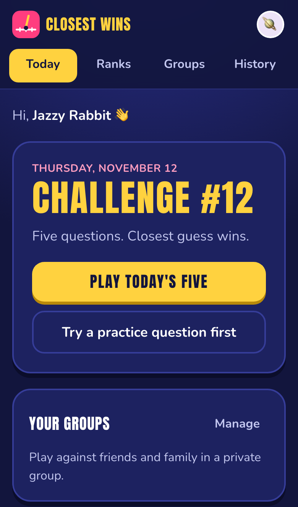
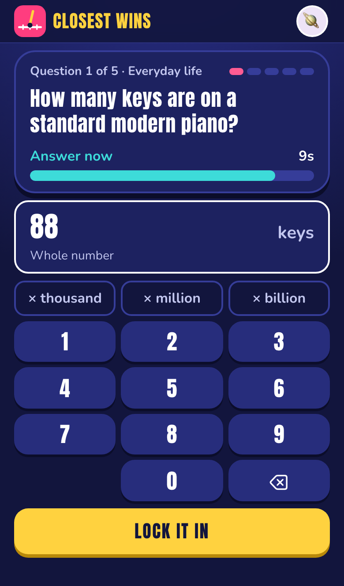
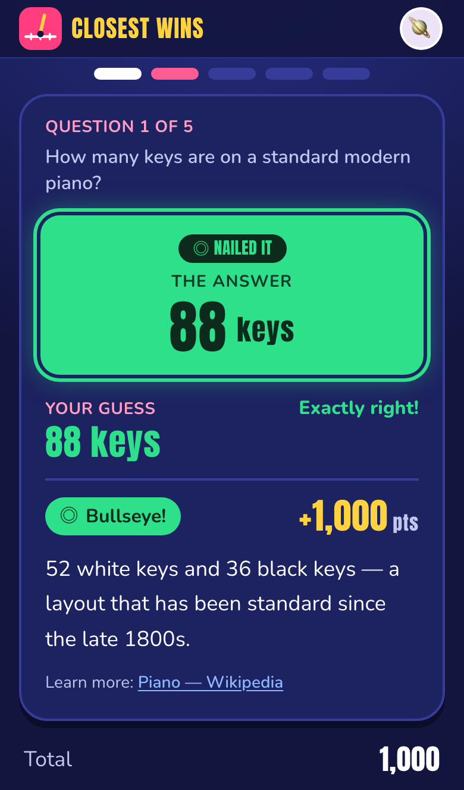
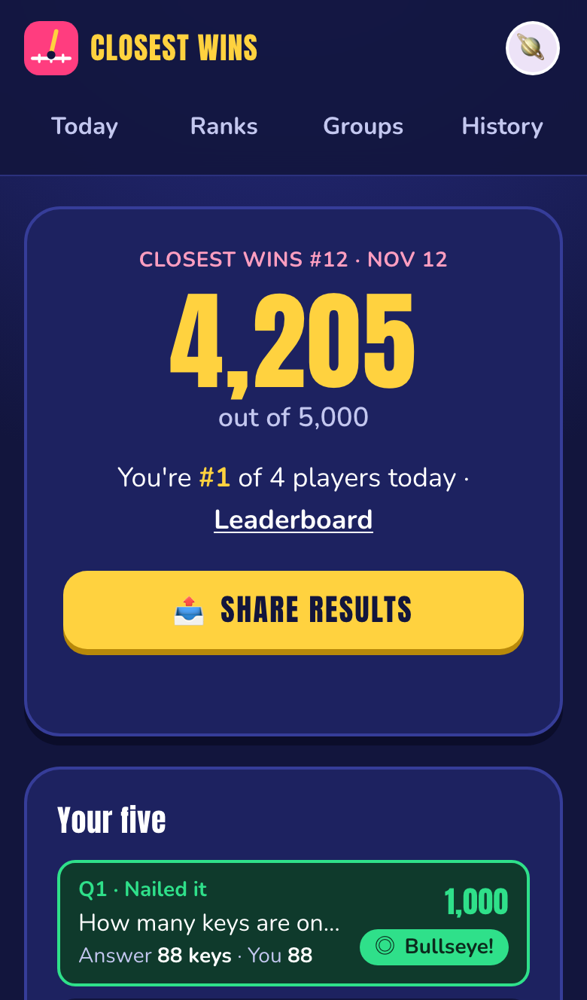
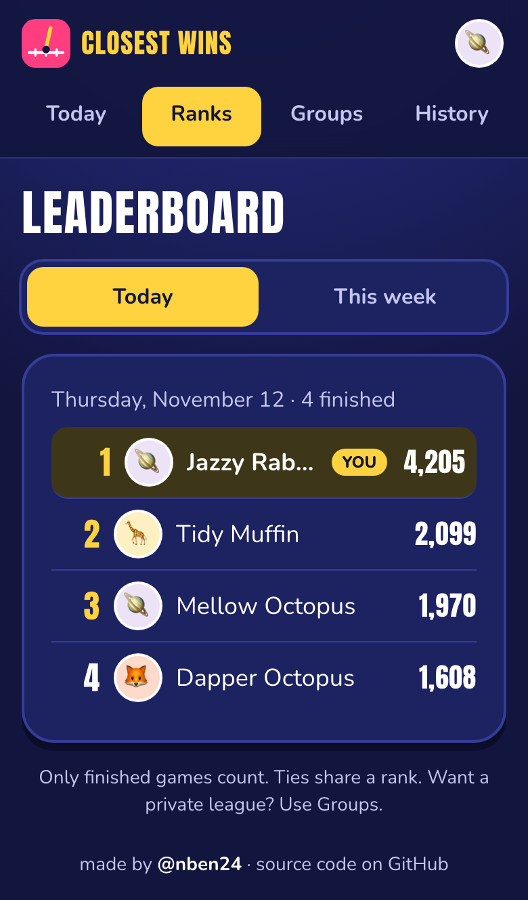

# Closest Wins

**Play:** https://closest-wins-game.vercel.app · Made by [@nben24](https://github.com/nben24), built with [Claude Code](https://claude.com/claude-code).

A mobile-first daily estimation game for friends and families. Everyone gets the same five numerical questions each day (America/New_York). Closer guesses earn more points — up to 1,000 per question. Private groups, daily and weekly standings, spoiler-free sharing, and a private admin area with AI-assisted, source-verified question generation.

<p align="center">
  
  
  
  
  
</p>
<p align="center"><sub>Home · Answering (10 seconds) · The reveal · Your results · Leaderboard</sub></p>

Stack: Next.js 16 (App Router, TypeScript), Tailwind CSS 4, Supabase (Postgres + anonymous Auth), Anthropic Claude API (optional), Vercel.

---

## Quick start (local, no accounts needed)

```bash
npm install
cp .env.example .env.local        # then edit: set LOCAL_ADMIN_PASSWORD, LOCAL_SESSION_SECRET; leave Supabase/AI blank
npm run dev                       # http://localhost:3000
```

With no Supabase variables set the app runs in **local mode**:

- An embedded Postgres (PGlite) stored in `.data/pglite`, migrated automatically on first request.
- 49 **demo questions** loaded automatically. They were written from general knowledge, are **not verified**, and are labeled "Demo questions · not verified" everywhere players see them.
- Guests are identified by a signed, httpOnly cookie.
- Admin: open `/admin`, sign in with `LOCAL_ADMIN_PASSWORD`.
- AI generation is disabled until `ANTHROPIC_API_KEY` is set; the admin UI says so. No paid calls happen otherwise.

Reset local data: stop the server and delete `.data/`.

### Checks

```bash
npm run lint
npm run typecheck
npm test            # 75 unit + integration tests (scoring, timing, DST, lifecycle, groups, pipeline…), real Postgres via PGlite
npm run test:e2e    # Playwright: builds production, plays full games on mobile + desktop viewports
npm run check       # lint + typecheck + tests + production build
```

`npx playwright install chromium` once before the first E2E run.

---

## Deploying (Supabase + Vercel)

**Step-by-step guide with exact click paths for every value: [docs/SETUP.md](docs/SETUP.md).** Summary below.

### 1. Supabase

1. Create a project at supabase.com.
2. **Authentication → Sign In / Providers**: enable **Anonymous sign-ins** (players) and keep **Email** enabled (admin login). Leave CAPTCHA off unless you add a CAPTCHA widget to the client (anonymous sign-in would fail otherwise).
3. Copy from **Project Settings → API**: the project URL and the **publishable** (anon) key.
4. Copy from **Connect → Transaction pooler** the connection string (port 6543) → `DATABASE_URL`.
5. Apply the schema (choose one):
   - `DATABASE_URL=... npm run db:migrate` (recommended), or
   - paste `supabase/migrations/*.sql` into the SQL editor, or `supabase db push`.
   Each migration records itself in `app_migrations`, so methods can be mixed safely.

The migration enables row-level security on every table **with no policies** and revokes all privileges from `anon`/`authenticated`. The browser key can only be used for sign-in; all data access goes through the server.

### 2. Make yourself an administrator

1. Supabase dashboard → **Authentication → Users → Add user** → your email + a strong password (auto-confirm).
2. From your machine: `DATABASE_URL=... npm run admin:grant -- you@example.com`
   (revoke: `npm run admin:grant -- --revoke you@example.com`).
3. Visit `/admin/login` on the deployed site.

Admin status is checked on the server for every admin page, action and API route (non-anonymous Supabase user **and** a row in `admins`). Grants and revocations are written to `audit_log`.

### 3. Vercel

1. Push this repository to GitHub and import it in Vercel (framework: Next.js; defaults are fine).
2. Set environment variables (Production + Preview) — see `.env.example`:
   `NEXT_PUBLIC_SUPABASE_URL`, `NEXT_PUBLIC_SUPABASE_PUBLISHABLE_KEY`, `DATABASE_URL` (all three are set automatically if you connect Supabase from Vercel's **Storage** tab — `POSTGRES_URL` is used as the database URL), `CRON_SECRET`, optionally `ANTHROPIC_API_KEY`, `ANTHROPIC_MODEL`, `DATABASE_CA_CERT`, `NEXT_PUBLIC_GAME_TITLE`, `NEXT_PUBLIC_GAME_LAUNCH_DATE`.
   Do **not** set `LOCAL_ADMIN_PASSWORD` or `ALLOW_DEMO_CONTENT=true` in production.
3. Deploy. Production deploys apply pending migrations automatically (`vercel.json` → `npm run vercel-build`); preview deploys don't touch the database schema. Local mode refuses to run on Vercel, so a missing variable fails loudly instead of silently using an ephemeral database.

**Scheduled job.** `vercel.json` runs `GET /api/cron/daily` at 05:15 UTC (just after midnight in New York). It publishes today's challenge, fills the schedule (if auto-schedule is on), raises low-inventory warnings, starts a replenishment job (if auto-generate is on), and advances generation jobs within a ~4-minute budget. Vercel sends `Authorization: Bearer $CRON_SECRET`. This works on the Hobby plan (one run per day).

Optional: to finish generation jobs faster without keeping the admin page open, call `GET /api/cron/jobs` with the same header from any external scheduler (e.g. every 10 minutes).

---

## Getting the first month of questions

1. Set `ANTHROPIC_API_KEY` (from console.anthropic.com → API keys). Optionally set a workspace spend limit there as a hard cap.
2. Admin → **Settings**: review the limits (defaults: 20 questions/job, 60 API calls/job, 250 proposals/month, **$3/month estimated**). Leave auto-approve **off** for now.
3. Admin → **Generate**: request 20 questions across all categories. Keep the job page open — it processes the job in bounded steps and shows each candidate, its source, the verbatim excerpt, and why it was accepted, held or rejected. Repeat until you have ~150–180 accepted/held candidates (30 days × 5, plus a reserve).
4. Admin → **Questions → status: review**: open each question, click the source, check the number/unit/period, run the independent source check if needed, then approve (individually, or select several and bulk-approve).
5. Admin → **Schedule → Fill empty days** (30 days). Review the sets; swap questions or unschedule days as needed. A day's set is snapshotted and locked when it's published (first player of the day or the daily cron).
6. Once you trust it, consider turning on **auto-schedule** and **auto-generate** (threshold: 14 days). Auto-approve is available but off by default.

If inventory runs out, today's set is assembled from the approved reserve and you are notified. Unapproved or demo content is never used in production.

**Corrections.** Published challenges are immutable. If a live answer is wrong, use Schedule → "Correct a mistake (void a question)". The question then scores 0 for everyone, is excluded from totals and the daily maximum, players see your reason, and the action is audited. The bank copy goes back to review for fixing.

---

## How it works

### Round timing (server-authoritative)

| Phase | Duration | Notes |
|---|---|---|
| Reading | 4 s | question shown, input disabled |
| Answering | 10 s | |
| Network grace | 1.5 s after the deadline | a submission *arriving* in this window counts; not extra thinking time — the on-screen timer ends at the deadline |
| Early tolerance | 0.3 s before answers open | absorbs clock-offset error |

`POST /api/play/begin` stamps `reading_started_at`, `answer_opens_at`, `deadline_at` in Postgres. Calling it again (refresh, second tab) returns the same round — time never resets. The client timer only displays those server times (offset estimated NTP-style from each response). At the deadline the client submits whatever was typed; anything arriving after the grace window is recorded as timed out (0 points). Expired rounds are finalized whenever state is read. Every write locks the attempt row in a transaction; finalized rounds cannot be changed (database trigger); unique constraints prevent duplicate attempts/rounds. Submissions are idempotent.

**Limitations (honest):** a browser cannot prove when an answer was typed. A player could read the question and look it up within 14 seconds, play from a second device or identity, or use slow-network grace. Anonymous identities can be recreated by clearing site data or switching browsers; we deliberately do not fingerprint devices. This is fair-play friction for a casual game, not anti-cheat.

### Scoring (`src/lib/scoring.ts`)

`points = round(1000 × 2^(−(e / t)^1.5))`, integer in [0, 1000]; exactly 1000 only for an exact answer.

| Type | Error `e` | Tolerance `t` (half-points distance) |
|---|---|---|
| ratio | \|ln(guess/answer)\| | ln(factor), entered as a factor e.g. ×1.5 |
| year | years off | years, e.g. 5 |
| percent | percentage points off | points, e.g. 8 |
| absolute | units off | units (small counts, zero or negative answers) |

At `e = t` a guess earns 500; `0.5t` → 783; `2t` → 141; `3t` → 27. Ratio scoring is symmetric (2× too high = 2× too low) and unit-invariant. Non-positive guesses on ratio questions, blanks and invalid input score 0. Speed never matters. Scoring settings are copied into the published snapshot so everyone is judged the same way. Ties share rank (1, 1, 3). Weekly standings: Monday–Sunday (New York), sum of each player's best five days, with days counted shown.

### AI generation and verification (`src/lib/server/ai/`)

Provider: Anthropic Claude via the official SDK. Default model `claude-haiku-5-5` (cheapest), configurable with `ANTHROPIC_MODEL`. On models that support it (Sonnet 5.5, Opus 5.5) requests opt into server-side refusal fallbacks; Haiku has none, so a refusal simply holds the candidate for review.

1. **Propose** — structured output (JSON schema) with content guidelines; validated with Zod.
2. **Local checks** (free) — prompt length (4-second read), scoring validity, family suitability, banned topics (e.g. net worth), undefined "average", relative time, exact/near duplicates. Failures are rejected before any research spending.
3. **Research** — fetch-first: the proposer suggests a source URL, the research step fetches it (web fetch has no per-use fee) and only falls back to web search (max 2, $0.01 each) if the page doesn't hold up; the model must return the source URL, a verbatim excerpt, the value it found, the unit and period, and judge ambiguity and conflicts. Fetched pages are treated as untrusted data (explicitly instructed; output is schema-validated; decisions are made in code).
4. **Independent check** — the server fetches the cited page itself (public http(s) only, SSRF-guarded, size/time-limited) and requires the excerpt to be on the page *and* to contain the answer number. A second model agreeing is never sufficient.
5. **Decide** — *accepted* → review queue (or approved if auto-approve is on and every check passed); *held* (unsupported, contradicted, conflicting, inaccessible, ambiguous, low-quality domain, wording mismatch) → review queue with reasons; *rejected* (unsafe, invalid, duplicate) → kept with reasons. You can re-verify, regenerate, or turn a rejected idea into an editable draft.

Jobs are durable rows advanced in bounded steps under a lease, so they survive timeouts and can be resumed by the admin page, the request that created them (`after()`), or cron.

### Security summary

- RLS on all tables with no policies; `anon`/`authenticated` hold no privileges. Server routes use a privileged connection and enforce identity, ownership, membership and admin role in code.
- Answers, explanations and sources are only returned for finalized rounds; group answer comparisons only after the viewer completes the day; only submitted answers are compared; non-members get the same 404 as a missing group.
- Nicknames/avatars/group labels come only from reviewed word lists, re-validated on the server; combinations screened; no free text anywhere.
- Postgres-backed rate limits on play, profile, group creation, joins (brute-force protection for invite codes), invite previews and local admin login. IPs are only stored as salted hashes.
- Secrets only in environment variables; `.env*` is gitignored except `.env.example`.

---

## Costs and how to limit them

| Service | What costs money | Controls |
|---|---|---|
| Anthropic API | Tokens + web searches during question generation only (never during gameplay) | No key = no calls. Monthly **estimated** cost cap (default **$3**, jobs pause when reached), monthly proposal cap, per-job question/API-call caps, proposals capped at 2× target, bounded retries. Also set a hard spend limit in the Anthropic console. |
| Supabase | Free tier covers family/friends scale (note: free projects pause after ~1 week without activity) | Monitor in the dashboard. |
| Vercel | Hobby (free) tier: one cron per day, enough here | — |

**Estimate with the default model (Haiku 5.5):** about $0.005–0.02 per researched candidate (mostly the optional $0.01 web searches; fetching a page is not metered). Keeping a fresh day every day needs ~150 approved questions/month ≈ 200–250 candidates ≈ **$2–4/month**. Generating the first month up front costs about the same once. Switching to `claude-sonnet-5-5` or `claude-opus-5-5` gives more thorough research at roughly 10–40× the cost — raise the monthly cap if you do. The admin usage log shows estimates from list prices, not your invoice.

To spend even less: generate in small batches, approve what's held instead of regenerating, or turn auto-generate off and top up by hand.

## Project layout

```
src/app/(game)/        player pages (home, play, practice, results, groups, join, history, profile, about)
src/app/admin/         admin pages + server actions
src/app/api/           JSON API routes (play, groups, results, cron, admin job advance)
src/lib/scoring.ts     scoring formulas          src/lib/time.ts      New York dates, weeks, DST
src/lib/names.ts       approved names/avatars    src/lib/scheduler.ts balanced daily sets
src/lib/server/        play lifecycle, challenges, groups, results, admin services, AI pipeline
supabase/migrations/   SQL schema (RLS, triggers, constraints)
scripts/               db:migrate, db:seed-demo, admin:grant
tests/  e2e/           Vitest + Playwright
```

Rename the game with `NEXT_PUBLIC_GAME_TITLE`.
